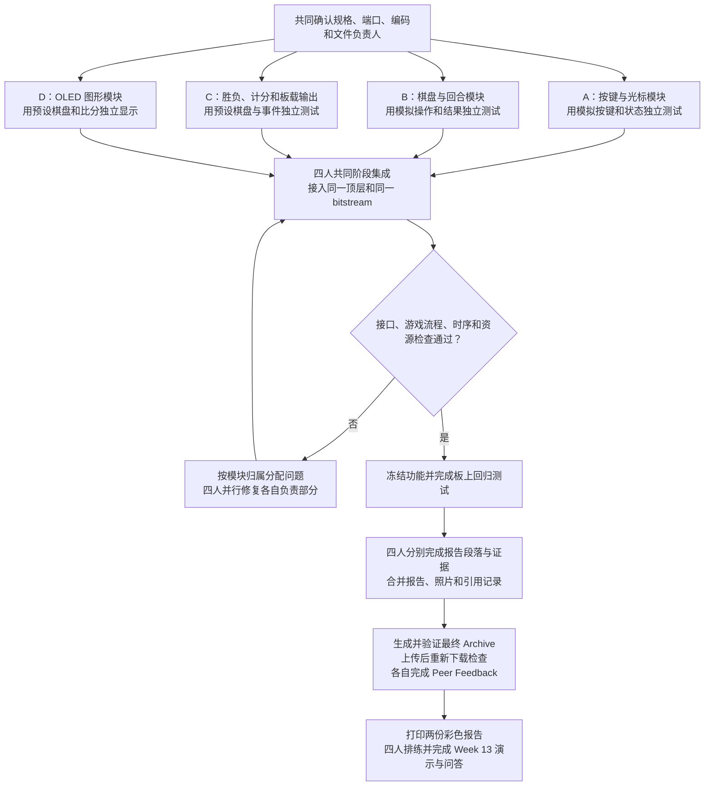
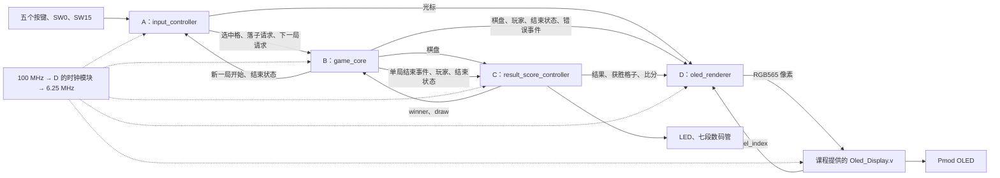
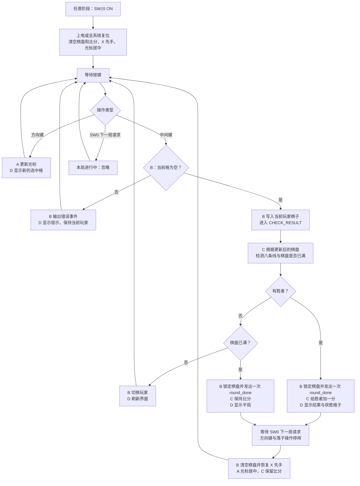

# EE2026 双人井字棋：四人并行分工、模块接口与 DDL

编写日期：2026-10-18。全部时间采用新加坡时间（SGT，UTC+8）。

项目：在一块 Basys3 上实现本地双人井字棋，用上下左右移动选格光标，中间键落子，Pmod OLED 显示游戏。四个人从第一天同时开发各自模块，最终集成为一个 bitstream。

本文是组内执行计划，不是 GPT-6 Proposal 或最终报告。成员姓名和 Group ID 尚未提供，暂用 A/B/C/D 和 `SX_YZ`；确定后替换即可。

下文的 `.v` 文件名和端口是拟实现的设计约定，目前工作区还没有这些源代码；实际开发时按本文件建立模块。第 3 节逐个说明主模块、子模块、课程驱动和测试模块的功能。

## 1. 共同确定的功能范围

| 项目 | 本项目约定 |
| --- | --- |
| 玩家 | 两名真人共用一套按键，轮流使用 X、O |
| 方向键 | 移动光标，到棋盘边缘停止 |
| 当前选中位置 | 用黄色高亮边框标出；光标可移到已有棋子的格子，但不能覆盖棋子 |
| 中间键 | 在当前选中格落子；已占用格子不允许重复落子 |
| 当前玩家 | X 先手，成功落子并确认游戏未结束后切换玩家 |
| 换人后的光标 | 保留在刚才落子的格子，由下一位玩家移动；只有新一局或全复位才回到中心 |
| 胜负 | 三横、三竖、两条对角线；棋盘满且无人获胜为平局 |
| 游戏结束 | 锁定落子，显示获胜格子或平局 |
| SW0 | 从 OFF 切到 ON 请求下一局；仅在游戏结束后生效，保留累计比分 |
| SW15 | ON 时全系统复位并清空比分，切回 OFF 后开始新游戏 |
| OLED | 96×64，显示棋盘、X/O、光标、当前玩家、结果与比分 |
| LED | 显示当前玩家和结束状态 |
| 七段数码管 | 四位显示 X、O 各两位累计胜场，例如 `0201` 表示 X 赢 2 局、O 赢 1 局 |

比分到 99 后保持 99；平局不增加任何一方胜场。先完成以上功能，再考虑细节优化。

## 2. 四人职责与文件所有权

### A：按键、开关与光标交互

主模块：`input_controller.v`。

负责文件：`button_event.v`、`input_controller.v`、`tb_input_controller.v`。

- 五个按键及开关输入的同步处理。
- 按键消抖：快速响应首次按下，随后约 200 ms 屏蔽抖动；长按只算一次，释放后才能再次触发。
- 光标位置寄存器、上下左右移动、边界限制。
- 中间键产生单周期落子请求。
- SW0 产生单周期下一局请求；SW15 生成同步的全系统复位信号。
- 新一局开始时光标回到中心；结束后冻结光标。
- 多键冲突处理：确认键优先于方向键；多个方向同时有效时固定为上、下、左、右优先。

**只写入：** 按键内部状态、光标、输入事件。不会写入棋盘或比分。

**独立开发方法：** 在 testbench 中自行产生按键抖动、短按、长按、开关变化，以及假的 `game_over`、`round_start`。

**验收：** 短按不漏检；长按 5 秒仍只有一次事件；光标永不越界；一次确认仅产生一次落子请求；新一局回到中心。

### B：棋盘、落子与回合状态机

主模块：`game_core.v`。

负责文件：`game_core.v`、`tb_game_core.v`、`My_Top_Module.v` 的模块连接部分。

- 唯一负责九格棋盘寄存器的写入与清空。
- 判断落子位置是否为空，接受合法落子，拒绝无效落子。
- 管理当前玩家以及 `WAIT_MOVE / CHECK_RESULT / GAME_OVER` 状态。
- 落子后进入检查状态，读取 C 的胜负结果，再决定结束或切换玩家。
- 输出合法落子、无效落子、新一局开始、单局结束的单周期事件。
- 游戏结束后拒绝落子；处理下一局请求及全系统复位。
- 维护顶层模块实例化和连线；各成员共同检查各自端口。

**只写入：** 棋盘、当前玩家、游戏状态、游戏事件。不会自己实现第二套胜负判断。

**独立开发方法：** testbench 直接发送假的光标、确认事件和 C 的结果信号，验证游戏状态机，不需要等 A/C/D。

**验收：** 每次合法确认只改变一个格子；无效落子不换人；结束后棋盘锁定；胜负检查使用落子后的棋盘；每局最多产生一次结束事件。

### C：胜负检测、累计比分与板载状态输出

主模块：`result_score_controller.v`。

负责文件：`result_detector.v`、`score_counter.v`、`sevenseg_driver.v`、`result_score_controller.v`、`tb_result_score_controller.v`。

- 对棋盘做组合逻辑分析，检测八条获胜线。
- 输出获胜玩家、平局标志和 9-bit 获胜格子掩码。
- 若最后一步同时填满棋盘并形成获胜线，优先判为获胜。
- 收到 B 的单周期 `round_done` 后，累计对应玩家胜场一次。
- 下一局保留比分，全系统复位清空比分，99 分饱和处理。
- LED 编码与七段数码管动态扫描、数字译码。

**只写入：** 累计比分和板载输出状态。胜负结果由棋盘组合生成，不写入棋盘或控制玩家切换。

**独立开发方法：** testbench 直接输入预设棋盘、当前玩家、结束事件；在板上可用固定比分测试七段数码管。

**验收：** X/O 的八种连线均正确；空棋盘不算获胜；平局与获胜不冲突；同一胜局保持显示不会重复加分；下一局保留比分；复位清零。

### D：OLED 图形与显示接入

主模块：`oled_renderer.v`。

负责文件：`oled_renderer.v`、`clock_gen.v` 或对应时钟 IP 配置、`tb_oled_renderer.v`、仅测试时使用的 `display_test_pattern.v`；作为 `Basys3_Master.xdc` 的唯一编辑人，维护时钟和板卡引脚约束，其他成员提供各自的引脚需求。

- 接入课程提供的 `Oled_Display.v`，使用其像素索引和输出接口。
- 根据像素索引生成 x/y 坐标，绘制网格、X/O 和光标。
- 显示当前玩家、小型比分数字、获胜或平局提示。
- 按 `winning_mask` 高亮获胜格子；将瞬时无效落子事件延长为肉眼可见的提示。
- 提供统一的 6.25 MHz 系统时钟并完成时钟约束，连接 OLED 驱动。
- 使用固定测试棋盘逐个验证显示场景。

**只写入：** 像素颜色及显示提示计时状态。不会修改光标、棋盘、胜负结果或比分。

**独立开发方法：** 从第一天用固定棋盘、光标、比分和结果作为输入，在 OLED 上画图；集成时将这些测试输入替换成 A/B/C 的实际输出。

**验收：** 九格均能正确显示 X/O；九个位置的光标无偏移；提示不遮挡棋盘；X 胜、O 胜、平局、无效落子均可辨认。

### 工作量平衡与共同工作

| 成员 | 主要实现工作 | 独立验证工作 | 分担的公共工作 |
| --- | --- | --- | --- |
| A | 同步、消抖、输入仲裁、光标与操作事件 | 抖动、短按、长按、边界与冲突输入 | 维护接口约定和集成问题清单 |
| B | 棋盘写入、合法性检查、回合状态机和事件时序 | 落子、换人、复位、结束锁定 | 维护顶层连线与项目源文件清单 |
| C | 胜负、获胜掩码、比分、七段扫描和 LED | 八条线、平局、只计一次、比分边界 | 汇总全系统测试结果与提交检查表 |
| D | OLED 图形、小型文字数字、提示计时和时钟接入 | 预设画面、坐标、提示及显示时序 | 汇总显示接线、实物照片和资源检查结果 |

目标是每人约承担四分之一的实现与验证工作，不能只按文件数量判断。D 的首版采用简单图形和小字模，控制显示工作量；C 同时负责计分与数码管，保证其工作不局限于八条线判断。第一次集成后按实际耗时调整完整子模块的归属，并同步修改接口和文件负责人。

每个人都负责自己的 testbench、问题修复、个人报告段落、引用记录和演示讲解。顶层维护和最终上传不代替个人模块开发。

## 3. 每一个 Module 的详细功能

### 3.1 模块层级与归属总览

下面是最终系统的实例关系。Testbench 和固定画面发生器用于独立测试，不进入最终游戏 bitstream。

```text
My_Top_Module                         B：最终顶层，只实例化和连线
├── clock_gen                         D：生成公共 6.25 MHz 时钟
├── input_controller                  A：输入事件、光标和公共复位
│   └── button_event × 6              A：五个按钮 + SW0，各自独立消抖
├── game_core                         B：棋盘、合法落子和回合状态机
├── result_score_controller           C：将结果、计分和板载输出接在一起
│   ├── result_detector               C：分析棋盘的胜负和平局
│   ├── score_counter                 C：累计 X/O 胜场
│   └── sevenseg_driver               C：四位数码管扫描和译码
├── oled_renderer                     D：根据游戏状态计算像素颜色
└── Oled_Display                      课程提供：OLED 初始化和串行传输

独立测试时使用：
├── display_test_pattern              D：向 oled_renderer 提供预设画面状态
├── tb_input_controller               A：输入交互仿真
├── tb_game_core                      B：棋盘与状态机仿真
├── tb_result_score_controller        C：结果、计分和板载输出仿真
└── tb_oled_renderer                  D：像素颜色和显示场景仿真
```

### 3.2 `button_event.v`：将一个物理按键变成一次事件（A）

| 项目 | 功能约定 |
| --- | --- |
| 输入 | `clk`、`rst`、`key_async`；`key_async=1` 表示按下或开关为 ON |
| 输出 | `key_pulse`：检测到一次有效按下时，只持续一个时钟周期 |
| 内部状态 | 两级同步寄存器、1 ms 采样计数器、200 ms 屏蔽计数器、释放确认计数器、是否允许再次触发的标志 |
| 实例数量 | 五个方向/确认按键各一个，SW0 再用一个；六路状态完全独立 |
| 复位行为 | 清空事件和计数器，等待输入先释放，再允许下一次按下触发 |

处理过程：异步输入先经过两级触发器同步，再约每 1 ms 采样。首次识别到按下时立即发出 `key_pulse`，进入约 200 ms 的屏蔽期；不能先等待按住 200 ms 才响应。屏蔽期结束后，若输入仍保持按下，则继续等待；确认输入连续约 20 ms 为释放状态后重新使能。

因此，一次带抖动的按下只发出一次事件，按住 5 秒也不会连发。需要第二次事件时必须释放再按。各计时长度和时钟频率使用参数表达，仿真时可以缩短参数来加快测试。

本模块只识别一个按键事件，不知道棋盘位置、当前玩家或该次落子是否有效。SW15 的复位同步链由 `input_controller` 单独实现，不经过这个需要 `rst` 的消抖模块。

### 3.3 `input_controller.v`：解释操作并保存光标位置（A）

| 项目 | 功能约定 |
| --- | --- |
| 输入 | `clk`、五个原始按键、`sw0_async`、`sw15_async`、B 的 `game_over` 和 `round_start` |
| 输出 | `rst`、`cursor_cell[3:0]`、`place_req`、`new_round_req` |
| 内部状态 | `cursor_cell`、六路 `button_event` 的状态、SW15 的独立同步链 |
| 初始/复位位置 | `cursor_cell=4`，即中心格 |

本模块实例化六个 `button_event`。SW15 的同步链独立工作，不使用其自身产生的 `rst` 清零；同步链上电初值设为高，使游戏逻辑先处于复位状态，待同步确认 SW15 为 OFF 后释放复位。

把格子编号转换为 `row=cursor_cell/3`、`col=cursor_cell%3`，按以下规则更新位置：

| 事件 | 更新条件与操作 |
| --- | --- |
| 上 | `row>0` 时，格子编号减 3 |
| 下 | `row<2` 时，格子编号加 3 |
| 左 | `col>0` 时，格子编号减 1 |
| 右 | `col<2` 时，格子编号加 1 |
| 中间确认 | 当前位置保持不变，输出一次 `place_req` |
| B 发出 `round_start` | 光标回到中心，不产生落子请求 |
| SW0 上升沿 | 输出一次 `new_round_req`，由 B 判断当前是否允许开启下一局 |

处理优先级为：全复位、`round_start`、正常游戏输入。在正常游戏输入中，确认优先于方向键，方向键优先级为上、下、左、右；被压过的同周期事件不排队重放。`game_over=1` 时冻结光标并屏蔽确认，但 SW0 和 SW15 仍有效。

A 不读取棋盘，光标可以移到已占用的格子；是否允许落子由 B 决定。成功落子后 A 不自动移动光标，所以换人后黄色边框停在原格。

### 3.4 `game_core.v`：保存棋盘并控制一整局（B）

| 项目 | 功能约定 |
| --- | --- |
| 输入 | `clk`、`rst`、A 的 `cursor_cell/place_req/new_round_req`、C 的 `winner/draw` |
| 输出 | `board[17:0]`、`current_player`、`game_over`、`move_ok_pulse`、`move_error_pulse`、`round_start`、`round_done` |
| 内部状态 | 九格棋盘、当前玩家、游戏状态；各事件输出默认在下一个周期恢复为 0 |
| 复位行为 | 棋盘清空、X 先手、进入 `WAIT_MOVE`、清空所有事件 |

| 状态 | 接受什么输入 | 执行什么动作 | 转移条件 |
| --- | --- | --- | --- |
| `WAIT_MOVE` | 接受 `place_req` | 检查位置范围 0–8，以及该格是否为 `00`；合法则写入 X/O 并发出成功事件；无效则发出错误事件且不换人 | 合法落子后进入 `CHECK_RESULT`；其他情况保持 |
| `CHECK_RESULT` | 读取 C 的 `winner/draw` | 若有胜者或平局，发出一次 `round_done`；否则切换当前玩家 | 结束则进入 `GAME_OVER`，否则回到 `WAIT_MOVE` |
| `GAME_OVER` | 只接受 `new_round_req` 和复位 | 锁定棋盘；下一局请求有效时清空棋盘、恢复 X 先手，并发出 `round_start` | 接受下一局后回到 `WAIT_MOVE` |

`game_over` 由已寄存的 `GAME_OVER` 状态产生。下一局不修改 C 的比分；全系统复位通过公共 `rst` 同时清空 C 的比分。

本模块是棋盘的唯一写入方。B 使用 C 的结果来控制状态，不再复制八条线判断；也不会向 OLED 直接画图。落子后必须等到下一个时钟沿才读取结果，避免检查到落子前的棋盘。

### 3.5 `result_detector.v`：判断当前棋盘的结果（C）

| 项目 | 功能约定 |
| --- | --- |
| 输入 | `board[17:0]` |
| 输出 | `winner[1:0]`、`draw`、`winning_mask[8:0]` |
| 逻辑类型 | 纯组合逻辑；不保存比分、不需要 `clk` 或 `rst` |

对下面八组格子进行比较：`0-1-2`、`3-4-5`、`6-7-8`、`0-3-6`、`1-4-7`、`2-5-8`、`0-4-8`、`2-4-6`。一条线只有在三格相同且都是合法 X 或 O 编码时才算获胜。

有获胜线时输出相应 `winner`，把该线三个格子的 mask 位设为 1；同时形成多条线时，将掩码合并。没有获胜线且九格都非空时，`draw=1`。默认输出为 `winner=00`、`draw=0`、`winning_mask=0`，组合逻辑所有分支都必须赋值，避免推导出锁存器。

本模块只分析 B 产生的合法游戏棋盘，不负责判断历史落子顺序。它在整局游戏中一直工作，不是只在落子脉冲到来时工作。

### 3.6 `score_counter.v`：每局结算一次胜场（C）

| 项目 | 功能约定 |
| --- | --- |
| 输入 | `clk`、`rst`、B 的 `round_done`、检测模块的 `winner` |
| 输出 | `score_x[7:0]`、`score_o[7:0]`，均为两位 BCD |
| 内部状态 | 两名玩家的十位与个位寄存器 |
| 复位行为 | 两名玩家比分全部变为 `00` |

每个上升沿：若 `rst=1`，先清零；否则只在 `round_done=1` 时结算。`winner=01` 给 X 加 1，`winner=10` 给 O 加 1，`winner=00` 视为平局，不加分。

个位 0–8 时只增加个位；个位 9 时清为 0 并给十位加 1；已经是 99 时保持不变。不接收下一局清零信号，因此普通换局自然保留比分。

计分事件由 B 保证只有一个周期。即使胜利棋盘停留数秒、`winner` 始终有效，只要没有新的 `round_done`，比分就保持不变。

### 3.7 `sevenseg_driver.v`：把比分显示在四位数码管上（C）

| 项目 | 功能约定 |
| --- | --- |
| 输入 | `clk`、`rst`、`score_x[7:0]`、`score_o[7:0]` |
| 输出 | `seg[6:0]`、`an[3:0]`、`dp` |
| 内部状态 | 扫描计数器和当前扫描的数位编号 |
| 显示顺序 | 从左到右为 X 十位、X 个位、O 十位、O 个位 |

用时钟使能约每 1 ms 切换一位，一次只选通一个 anode，约 4 ms 完成一次四位扫描。将当前数位对应的 BCD 值译码为 0–9 的七段图案；`dp` 保持关闭。引脚与有效电平按 Basys3 约束连接，数字译码统一在本模块内处理。

复位期间关闭数位输出并复位扫描计数器，释放复位后显示 `0000`。本模块只显示输入比分，不负责计算或保存比分。

### 3.8 `result_score_controller.v`：组织 C 的三个子模块及 LED（C）

| 项目 | 功能约定 |
| --- | --- |
| 输入 | `clk`、`rst`、`board`、`current_player`、`game_over`、`round_done` |
| 输出 | `winner`、`draw`、`winning_mask`、`score_x/score_o`、`led[15:0]`、`seg/an/dp` |
| 内部结构 | 实例化 `result_detector`、`score_counter`、`sevenseg_driver` |

将棋盘送给检测模块；把检测结果和单局结束事件送给计分模块；把比分送给七段数码管驱动。`winner/draw` 同时返回给 B，结果、掩码和比分同时送给 D。

LED 采用固定约定：游戏进行中，`led[0]` 表示轮到 X，`led[1]` 表示轮到 O；结束后这两灯熄灭，`led[2]` 点亮。`led[15:3]` 保持熄灭，复位时所有 LED 熄灭。

这个主模块主要负责 C 内部的连线和 LED 编码；比分寄存器仍只存在于 `score_counter`，不再保存第二份。

### 3.9 `oled_renderer.v`：将游戏状态转换成像素颜色（D）

| 项目 | 功能约定 |
| --- | --- |
| 输入 | `clk`、`rst`、`pixel_index`、`cursor_cell`、`board`、`current_player`、`game_over`、`move_error_pulse`、`winner/draw/winning_mask`、`score_x/score_o` |
| 输出 | `oled_data[15:0]`，即当前像素的 RGB565 颜色 |
| 内部状态 | 无效操作提示计时器；棋盘、光标、玩家和比分直接读取外部输入，不在此修改 |
| 复位行为 | 清除错误提示；复位释放后根据空棋盘和零比分绘制起始画面 |

通过 `x=pixel_index%96`、`y=pixel_index/96` 得到当前像素位置，然后判断它属于哪个图形区域。建议左侧安排约 60×60 像素的棋盘，每格约 20×20；右侧约 32 像素宽用于玩家、结果和比分小字，具体边距由 D 固定。

| 绘制部分 | 要完成的功能 |
| --- | --- |
| 网格 | 绘制两横两竖分隔线和需要的外框，使九格边界清楚 |
| 棋子 | 按对应格子的 2-bit 状态绘制红色 X、蓝色 O；空格不画棋子 |
| 光标 | 在 `cursor_cell` 对应格内画黄色边框，给棋子留出内部空间；即使该格已有棋子，边框和棋子仍都可见 |
| 当前玩家 | 游戏进行中在右侧显示 X 或 O，随 B 的 `current_player` 自动改变 |
| 获胜格子 | `game_over=1` 且有胜者时隐藏光标，将 `winning_mask` 对应格子的边框改为绿色 |
| 结果文字 | 结束后显示获胜玩家或 `DRAW`，普通回合提示让位给结束提示 |
| 比分 | 用小字模显示 X、O 的累计胜场，和七段数码管保持一致 |
| 无效操作 | 收到错误脉冲后，在右侧显示约 300 ms 的 `ERR` 提示；新错误重新计时，胜负结果显示优先 |

绘图可在同一文件里用组合判断、函数和小字模实现，不必为每条线或每种字符建立额外模块。像素重叠时统一按“文字区域内容、格子边框、棋子、网格、背景”的顺序决定颜色；文字区域与棋盘区域尽量不重叠。

黄色边框表达的是“目前选中了哪里”；红 X 和蓝 O 表达的是“哪些棋子已经落下”。因此方向键只移动边框，成功确认才会让棋盘增加一个固定棋子。

### 3.10 `clock_gen.v`：提供全系统公共时钟（D）

| 项目 | 功能约定 |
| --- | --- |
| 输入 | Basys3 的 `clk100mhz` |
| 输出 | `clk`，频率 6.25 MHz |
| 实现范围 | 使用合适的 FPGA 时钟资源或时钟 IP；相应配置文件属于 D |

100 MHz 到 6.25 MHz 的频率比为 16。生成的时钟应接入合适的时钟网络，并在 Vivado 中正确约束；所有游戏模块和 OLED 驱动都使用这一公共时钟。1 ms 采样、200 ms 消抖、数码管扫描等慢速操作由各自模块内部的计数器产生时钟使能，不另外创建慢时钟域。

SW15 只复位游戏和显示状态，不关闭公共时钟，否则复位同步和后续恢复都无法工作。A/B/C 的仿真可以直接提供 6.25 MHz 测试时钟，独立开发不依赖这个模块先完成。

### 3.11 `Oled_Display.v`：课程提供的 OLED 设备驱动（接入归 D）

| 项目 | 功能约定 |
| --- | --- |
| 主要输入 | 6.25 MHz `clk`、`reset`、`pixel_data[15:0]` |
| 主要输出 | `pixel_index[12:0]`、`frame_begin`、`sending_pixels`、`sample_pixel` 及 OLED 设备控制引脚 |
| 功能 | 按课程模板完成 OLED 初始化，依次请求像素，并将像素数据串行发送给屏幕 |

连接时将 D 的 `oled_data` 接到驱动的 `pixel_data`，将驱动的 `pixel_index` 返回给 D；设备引脚按实际 Pmod 连接接入约束。`frame_begin/sending_pixels/sample_pixel` 按提供源码中的接口说明使用，暂时不需要的状态输出可以保持未连接。

本模块不理解井字棋规则，也不决定哪个格子画 X/O；它只负责把 D 给出的颜色发送到屏幕。使用课程提供的源码，原则上不修改驱动内部实现。实际开始接入时，应核对模板中的准确端口名称和复位要求。

### 3.12 `display_test_pattern.v`：提供预设游戏画面（D，仅测试）

| 项目 | 功能约定 |
| --- | --- |
| 输入 | 测试用 `scene_id`，例如来自 testbench 或测试顶层的开关 |
| 输出 | 一组假的 `board/cursor_cell/current_player/game_over/winner/draw/winning_mask/score_x/score_o`；测试错误事件由 testbench 或测试顶层单独产生 |
| 用途 | 在 A/B/C 尚未接入时，给 D 提供完整而稳定的绘图输入 |

至少提供空棋盘、混合 X/O、光标在九个位置、X 胜、O 胜、平局、比分 00/09/10/99 等场景。错误提示的触发由测试平台提供单周期事件；需要板上测试时，可以在测试顶层提供相同事件。

这个模块只生成测试数据，不承担真实的落子逻辑。独立 OLED 测试顶层可以将它接到 `oled_renderer`；最终 `My_Top_Module` 使用 A/B/C 的实际输出，不实例化此模块。

### 3.13 `My_Top_Module.v`：最终系统接线与引脚入口（B 维护，四人核对）

| 项目 | 功能约定 |
| --- | --- |
| 板上输入 | 100 MHz 时钟、五个按键、SW0、SW15 |
| 板上输出 | LED、七段数码管、OLED Pmod 引脚 |
| 内部状态 | 不新增棋盘、光标或比分寄存器，数据分别由 A/B/C 唯一保存 |

负责实例化层级图中的最终模块，传递公共时钟与复位，按信号表连接 A→B、B↔C、A/B/C→D 和 D↔OLED 驱动。所有板上输入输出在这里暴露，再由 `Basys3_Master.xdc` 映射到实际引脚。

B 负责维护该文件，但 A/C/D 分别检查自己模块的端口、位宽、复位方向和连接是否正确。顶层不包含另一套游戏算法，也不保留测试棋盘选择逻辑。

### 3.14 四个 Testbench：各自模块的独立验证工具

Testbench 是仿真模块，没有需要连接到开发板的输入输出端口；它们产生时钟和测试输入、实例化被测模块、比较实际输出与预期结果，不综合进最终硬件。

| Testbench | 负责产生的输入 | 必须验证的输出和行为 |
| --- | --- | --- |
| `tb_input_controller.v`（A） | 按键抖动、短按、长按、同时按键、SW0/SW15、新一局与结束状态 | 每次操作只有一个事件；九格移动与边界正确；落子后光标保留；复位和换局回到中心；结束时输入规则正确 |
| `tb_game_core.v`（B） | 预设选中格、落子请求、下一局请求、模拟胜负结果 | 棋盘只改一个格子；非法操作不换人；检查状态延迟正确；结束只发一次事件；结束后锁定；下一局清盘 |
| `tb_result_score_controller.v`（C） | 空盘、进行中、八类 X/O 胜局、平局、最后一格获胜、结束脉冲和复位 | 结果与掩码正确；胜场只按结束事件更新；BCD 进位和饱和正确；LED 编码和数码管扫描正确 |
| `tb_oled_renderer.v`（D） | 测试棋盘、各格光标、胜负结果、比分、错误脉冲，以及像素索引扫描 | 网格/背景/棋子/光标关键像素颜色正确；获胜高亮正确；错误提示持续时间正确；状态更新不修改游戏数据 |

四人都可以在自己的 testbench 中直接构造其他模块的输出，不需要先运行完整游戏。最终集成时再共同验证真实模块之间的交互。

### 3.15 `Basys3_Master.xdc`：公共约束文件，不是功能模块（D 维护）

为顶层时钟、按钮、开关、LED、数码管和 OLED 端口指定正确的物理引脚与 I/O 标准，并约束输入时钟和生成时钟。C 提供 LED/数码管端口需求，A 提供按钮/开关需求，B 提供最终顶层端口清单，由 D 统一修改文件。

它不实现任何游戏规则；约束文件和模块端口必须一致。OLED 的实际 Pmod 插座在集成前共同确认，并记录接线，避免各人分别假定不同连接位置。

## 4. 统一接口与时序约定

### 公共编码

- 游戏逻辑和 OLED 驱动统一使用 `clk = 6.25 MHz`；Basys3 的 100 MHz 输入只进入时钟生成模块。各自仿真直接产生 6.25 MHz 时钟即可，不需要等待 D 的时钟模块。
- 全部游戏寄存器采用上升沿更新，`rst` 为高有效同步复位；异步物理输入先同步。
- `board[17:0]`：每格 2 bit，`00=空`、`01=X`、`10=O`；格子 i 对应 `board[2*i +: 2]`。
- 格子从上到下、从左到右编号为 0–8；中心格为 4。
- `current_player`：`0=X`、`1=O`；`winner[1:0]`：`00=无胜者`、`01=X`、`10=O`。
- `winning_mask[i]=1` 表示格子 i 属于获胜连线；若同时出现多条获胜线，输出这些格子的并集。
- `score_x/score_o[7:0]` 使用两位 BCD，高 4 bit 是十位，低 4 bit 是个位，范围 00–99。
- 名称带 `_pulse`、`_req` 的事件及 `round_start/round_done` 均持续一个 `clk` 周期；持续状态与事件分别处理。

```text
棋盘编号                 每格编码
┌───┬───┬───┐           00：空
│ 0 │ 1 │ 2 │           01：X
├───┼───┼───┤           10：O
│ 3 │ 4 │ 5 │
├───┼───┼───┤
│ 6 │ 7 │ 8 │
└───┴───┴───┘
```

### 模块间信号

| 信号 | 位宽 | 唯一输出方 | 接收方 | 含义 |
| --- | --- | --- | --- | --- |
| `clk` | 1 | D 的时钟模块 | 全部模块 | 6.25 MHz 公共时钟 |
| `rst` | 1 | A | B、C、D 和 A 内部逻辑 | SW15 同步后的全系统复位 |
| `cursor_cell` | 4 | A | B、D | 当前选中格 0–8 |
| `place_req` | 1 | A | B | 确认键落子请求 |
| `new_round_req` | 1 | A | B | SW0 上升沿产生的下一局请求 |
| `board` | 18 | B | C、D | 棋盘状态 |
| `current_player` | 1 | B | C、D | 当前玩家 |
| `game_over` | 1 | B | A、C、D | 已进入结束状态 |
| `move_ok_pulse` | 1 | B | 顶层调试或测试平台 | 本次落子成功 |
| `move_error_pulse` | 1 | B | D | 本次落子位置越界或格子已占用 |
| `round_start` | 1 | B | A | 接受下一局请求后复位光标 |
| `round_done` | 1 | B | C | 单局结束，只触发一次计分 |
| `winner` | 2 | C | B、D | 当前棋盘的胜者 |
| `draw` | 1 | C | B、D | 满盘且无胜者 |
| `winning_mask` | 9 | C | D | 获胜格子集合 |
| `score_x/score_o` | 各 8 | C | D | 两位 BCD 累计胜场 |
| `led/seg/an/dp` | 分别为 16/7/4/1 | C | Basys3 引脚 | LED 与七段数码管输出 |
| `pixel_index` | 13 | 课程 OLED 驱动 | D 的绘图模块 | 0–6143 像素索引 |
| `oled_data` | 16 | D 的绘图模块 | 课程 OLED 驱动 | RGB565 像素颜色 |

### 一次落子的正确时序

1. B 在 `WAIT_MOVE` 收到 `place_req`，检查 `cursor_cell` 范围及对应格子是否为空。
2. 合法则在该时钟沿写入棋盘并进入 `CHECK_RESULT`；无效则发出错误脉冲，棋盘与玩家不变。
3. 更新后的棋盘驱动 C 的组合检测逻辑。
4. 下一时钟沿，B 读取 C 的 `winner/draw`。若未结束，切换玩家并回到 `WAIT_MOVE`；若结束，进入 `GAME_OVER` 并产生一次 `round_done`。
5. C 在之后的时钟沿接收 `round_done` 并计分；不能仅凭 `winner` 长时间有效就连续加分。

B 的棋盘与状态均为寄存器，因此 B↔C 的连接不会形成组合反馈环。C 输出的 `winner/draw` 描述棋盘结果；B 输出的 `game_over` 描述控制器是否已确认结束，两者职责不同。

全系统复位优先级最高。B 只在 `GAME_OVER` 接受下一局请求；游戏进行中忽略该请求。`CHECK_RESULT` 和 `GAME_OVER` 不接受新的落子请求。

## 5. 完整流程图

### 5.1 四人并行开发流程

本图中的分支是同时进行的工作。D 与其他三人处在同一层，从项目开始就开发和验证自己的模块。



### 5.2 最终系统模块连接图

这些箭头表示运行时信号连接，不表示开发先后顺序。



A 产生的公共 `rst` 接入各模块；为保持连接图清楚，图中省略复位连线。

### 5.3 玩家操作与单局运行流程



## 6. 官方 DDL：以 Manual 和后续 Canvas 公告为准

| 项目 | 官方时间 | 提交或展示要求 |
| --- | --- | --- |
| GPT-6 Proposal | **2026-10-19，星期一，06:00** | 每组一个 PDF；最多 2 页；文件名 `GPT6_SX_YZ.pdf`；上传 Canvas 的 `GPT-6 Document Submission` |
| 最终 Vivado Project Archive | **Week 12/13；本地 manual 未给出具体日时** | 每组一份；不超过 500 MB，超出须事先获准；全部功能在同一个已测试 bitstream 中 |
| 最终 PDF Report | **Week 12/13；本地 manual 未给出具体日时** | 按模板写明团队功能及各人组件，使用 OLED 实物彩色照片 |
| Peer Feedback | **Week 12/13；本地 manual 未给出具体日时** | 每人完成；细则在 Week 12 通过 Canvas 发布 |
| 现场评估 GPA-8 | **Week 13；具体时段以 Canvas 为准** | 团队演示约 2–5 分钟，另有问答；带两份彩色打印报告 |

当前只核对了工作区的 manual，没有核对 Canvas 最新公告，因此不能将“manual 未给出确切日期”理解为“Canvas 尚未公布”。最终三项提交各自的准确截止时间都需要从 Canvas 补入，不能假定三者完全相同。Manual 明确说明截止时间不可延期。

Manual 第 1 页标明 Week 9 从 2026-10-12 开始，据此顺延：Week 10 为 10/19–10/25，Week 11 为 10/26–11/01，Week 12 为 11/02–11/08，Week 13 为 11/09–11/15。日期范围只用于组内规划，具体提交和评估时段以 Canvas 为准。

**Week 10、11、12 均没有安排实验课。** 团队需要自行安排开发、板上测试和碰面时间，不要将集成工作留到下一次 scheduled lab。

## 7. 建议内部 DDL：四个人同批交付

以下是建议的组内进度，不是课程官方截止时间。若 Canvas 给出的提交日期更早，整体提前。

| 内部 DDL（SGT） | A 当期交付 | B 当期交付 | C 当期交付 | D 当期交付 | 全组验收 |
| --- | --- | --- | --- | --- | --- |
| 10/18 20:00 | 输入、光标端口和按键规则 | 棋盘编码、状态机端口 | 结果、比分、板载输出端口 | 像素、时钟、显示状态端口 | 接口和文件所有权确定；各人填写真实的 Week 7–9 工作记录 |
| 10/18 22:00 | 完成个人 proposal 内容 | 完成个人 proposal 内容并合并 | 检查任务安排、字数和文件名 | 检查 PDF 排版与上传回执 | 提前提交 proposal，正式截止为 10/19 06:00；不得编造已完成工作 |
| 10/20 22:00 | 消抖、单次事件和光标可独立运行 | 棋盘落子与回合状态机可独立运行 | 胜负检测可独立运行，数码管显示固定比分 | OLED 显示固定棋盘、X/O 和光标 | 四份模块均可编译；顶层接线完成并进行首次板上集成 |
| 10/23 22:00 | 真实按键接入，边界与长按通过 | 合法落子、换人、结果检查接入 | 胜负与单次计分接入 | 实际游戏信号替换测试输入 | 单一 bitstream 可玩完一局，支持重新开始 |
| 10/26 22:00 | 下一局、全复位、多键规则完成 | 游戏结束锁定、事件时序完成 | 累计比分、LED、七段显示完成 | 结果、比分和错误提示完成 | 完整功能集成，四人分别演示自己的组件 |
| 10/29 22:00 | 完成输入回归测试 | 完成状态机与顶层回归测试 | 完成全部胜负与计分边界测试 | 完成全部预设画面与实物显示测试 | 功能冻结；实现与时序检查通过，资源不超限；只修复问题 |
| 10/30 22:00 | 提交个人说明、测试记录和引用 | 提交个人说明、项目 Archive 与验证记录 | 合并报告、测试记录、提交检查表 | 提交个人说明、实物照片与接线证据 | 最终报告及 Archive 准备完成，保留可演示版本 |
| 各正式提交 DDL 前至少 24 小时 | 检查输入操作说明 | 上传 Archive 后重新下载验证 | 核对报告、字数及各项提交回执 | 检查照片和打印版本 | 对照各项官方截止时间完成提交；每人单独确认 Peer Feedback |
| 现场评估前至少 2 天 | 排练操作与个人讲解 | 检查最终 bitstream 并排练 | 排练胜负、计分、板载输出 | 排练 OLED 展示并检查打印件 | 全组完整彩排一次，演示控制在 2–5 分钟 |

集成时不要求所有功能一次到位。10/20 即使部分功能仍用固定值，也应先将四个真实模块接入；后续逐步替换模块内部的临时逻辑。测试用固定输入只能存在于测试平台或测试模式，最终版本必须使用真实游戏状态。

## 8. 互不干扰的协作规则

1. 每个寄存器、输出端口和源文件只有一个负责人；其他成员通过端口读取数据。
2. 每个人只修改自己负责的文件。需要改变公共接口时，在组内同步后，由文件负责人修改。
3. A/B/C/D 均用假的输入完成独立验证，不能把“等别人模块完成”作为开始工作的条件。
4. B 维护顶层连线，D 统一维护约束文件；其他成员提供自己端口的连接要求。公共配置有单一编辑人。
5. 所有模块使用相同的编码、时钟和复位约定。修改接口后，同步更新本文件、testbench 和顶层连线。
6. 每次集成后记录“问题、所属模块、负责人、修复时间”，问题回到对应负责人处理。
7. 每次成功的集成版本都保留副本；最终演示必须使用提交 Archive 中的同一套功能。

## 9. 最终验收与提交检查

- [ ] 五个按键短按和长按均可靠，光标不越界。
- [ ] 九个位置均能合法落子；占用格子不能覆盖，且不换人。
- [ ] X 和 O 的全部八种获胜连线通过测试，获胜掩码正确。
- [ ] 平局正确；最后一步形成胜局时不会误判平局。
- [ ] 结束后不能继续落子；下一局清空棋盘并保留比分。
- [ ] 每个胜局只加一次分；平局不加分；比分 99 饱和；全复位清零。
- [ ] OLED、LED、七段数码管显示与真实游戏状态一致。
- [ ] 所有功能在一个 bitstream 中完成，板上运行稳定，不需每局重新烧录。
- [ ] 综合与实现完成，时钟约束完整，无未解决的时序问题，FPGA 资源不超限。
- [ ] 每人可解释自己的模块、接口、关键时序和测试方法。
- [ ] Proposal 符合 2 页上限，主题至少 100 words，每位成员责任与计划部分至少 100 words。
- [ ] 最终报告前两页：团队主题和四位成员的五段说明合计不超过 500 words；按模板标注个人信息、字数和分区颜色。
- [ ] 最终报告第 3–4 页仅放课程反馈与参考资料；如需补充工具使用记录，按 manual 允许增加后续页。
- [ ] 报告只描述已实现且能够演示的功能，包含 OLED 实物彩色照片和整机连接照片。
- [ ] 报告记录开源代码、网站、Chatbot/AI 等参考及其具体使用方式。
- [ ] Archive 大小不超过 500 MB；上传后重新下载、解压，检查 bitstream 能否正确运行。
- [ ] 每人完成 Peer Feedback，并准备两份彩色打印报告。

## 10. 资料依据

来源：[EE2026 - Project Manual.pdf](<./EE2026 - Project Manual.pdf>)。

- 第 1 页：更新后的实验课安排，Week 10–12 无 scheduled lab，Week 13 评估。
- 第 3 页：Week 7–13 的项目任务与提交阶段。
- 第 10–11 页：替代项目主题、个人组件分工、系统集成和资源限制。
- 第 12 页：GPT-6 Proposal 格式和 2026-10-19 06:00 截止时间。
- 第 13–15 页：最终 Archive、报告、Peer Feedback、演示和打印要求。

本文件中的模块设计、控制映射和内部里程碑为针对本组双人井字棋的建议；课程硬性要求以 manual 和 Canvas 后续公告为准。
